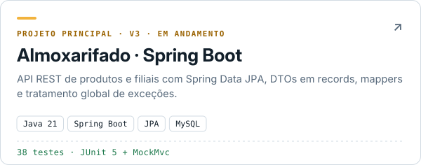
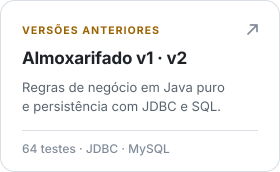
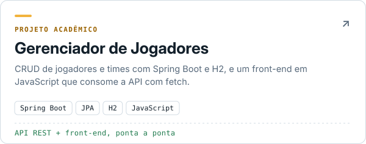
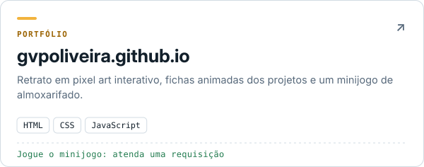

<a href="https://gvpoliveira.github.io">
  <picture>
    <source media="(prefers-color-scheme: dark)" srcset="./assets/header-dark.svg">
    
  </picture>
</a>

<p>
  <a href="https://gvpoliveira.github.io"></a>
  <a href="https://gvpoliveira.github.io/curriculo-gabriel-oliveira.pdf"></a>
  <a href="https://www.linkedin.com/in/gvpoliveira"></a>
  <a href="mailto:gabriel.vpoliveira@hotmail.com"></a>
</p>

### Sobre mim

```java
public class GabrielVinicius {

    private final String formacao = "Análise e Desenvolvimento de Sistemas · SENAC SP (2025–2028)";
    private final String objetivo = "Estágio em desenvolvimento backend com Java";
    private final String local    = "São Paulo – SP";

    private final List<String> stack = List.of(
        "Java", "Spring Boot", "Spring Data JPA", "MySQL", "JUnit 5", "MockMvc"
    );

    public String historia() {
        return "Trabalho no almoxarifado e transformo essa rotina em sistema: "
             + "o mesmo projeto reconstruído em POO, JDBC e Spring Boot.";
    }
}
```

### Stack

<p>
  
</p>

### Projetos

<table>
  <tr>
    <td width="50%">
      <a href="https://github.com/GvPOliveira/almoxarifado-v3">
        <picture>
          <source media="(prefers-color-scheme: dark)" srcset="./assets/card-almoxarifado-v3-dark.svg">
          
        </picture>
      </a>
    </td>
    <td width="50%">
      <a href="https://github.com/GvPOliveira/almoxarifado-system">
        <picture>
          <source media="(prefers-color-scheme: dark)" srcset="./assets/card-almoxarifado-v1-v2-dark.svg">
          
        </picture>
      </a>
    </td>
  </tr>
  <tr>
    <td width="50%">
      <a href="https://github.com/GvPOliveira/gerenciador-de-jogadores">
        <picture>
          <source media="(prefers-color-scheme: dark)" srcset="./assets/card-gerenciador-dark.svg">
          
        </picture>
      </a>
    </td>
    <td width="50%">
      <a href="https://gvpoliveira.github.io/#jogo">
        <picture>
          <source media="(prefers-color-scheme: dark)" srcset="./assets/card-portfolio-dark.svg">
          
        </picture>
      </a>
    </td>
  </tr>
</table>

<details>
<summary><b>Por que reconstruir o mesmo sistema três vezes?</b></summary>
<br>

Escolhi um domínio que conheço por dentro, o do meu trabalho no almoxarifado, e refiz o sistema a cada nova etapa de estudo. Assim, cada versão mostra na prática o que a tecnologia nova resolve.

```
v1 · POO  ─────▶  v2 · JDBC  ─────▶  v3 · Spring Boot
Java puro         MySQL + SQL         JPA + API REST
68 testes         transações          38 testes · em andamento
```

| Versão | O que aprendi |
| :-- | :-- |
| **v1 · POO** | Modelar regras de negócio com classes, Collections e exceções próprias, e garantir o comportamento com testes unitários |
| **v2 · JDBC** | Escrever SQL à mão, montar objetos a partir do `ResultSet` e controlar transações com commit e rollback |
| **v3 · Spring Boot** | Comparar todo esse trabalho manual com Spring Data JPA, expor uma API REST com DTOs e testar os endpoints com MockMvc |

</details>

<details>
<summary><b>O que estou estudando agora</b></summary>
<br>

- [ ] Regras de negócio da v3 com Spring: notas fiscais, requisições e estornos
- [ ] Testes automatizados no Spring
- [ ] Boas práticas de APIs REST

</details>

---

<sub>Sempre aberto a feedback sobre os meus projetos. Se quiser conversar, me chame no LinkedIn.</sub>
