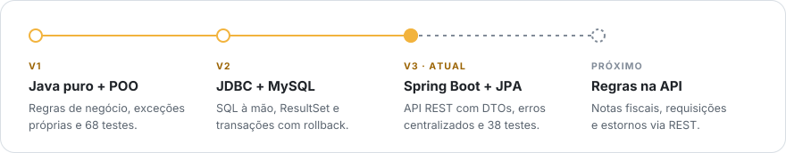

<a href="https://gvpoliveira.github.io">
  <picture>
    <source media="(prefers-color-scheme: dark)" srcset="./assets/header-dark.svg">
    
  </picture>
</a>

  <a href="https://gvpoliveira.github.io/curriculo-gabriel-oliveira.pdf"><picture><source media="(prefers-color-scheme: dark)" srcset="./assets/btn-curriculo-dark.svg"></picture></a>
  <a href="https://www.linkedin.com/in/gvpoliveira"><picture><source media="(prefers-color-scheme: dark)" srcset="./assets/btn-linkedin-dark.svg"></picture></a>
  <a href="https://gvpoliveira.github.io"><picture><source media="(prefers-color-scheme: dark)" srcset="./assets/btn-portfolio-dark.svg"></picture></a>
  <a href="mailto:gabriel.vpoliveira@hotmail.com"><picture><source media="(prefers-color-scheme: dark)" srcset="./assets/btn-email-dark.svg"></picture></a>

Estudante de Análise e Desenvolvimento de Sistemas no SENAC SP (2025–2028), em busca de **estágio em backend Java**. Trabalho como assistente de almoxarifado e uso essa rotina como laboratório: o mesmo sistema de estoque já foi reconstruído três vezes, de Java puro até uma API REST com Spring Boot.

### Projeto em destaque

<a href="https://github.com/GvPOliveira/almoxarifado-v3">
  <picture>
    <source media="(prefers-color-scheme: dark)" srcset="./assets/card-almoxarifado-v3-dark.svg">
    
  </picture>
</a>

### Outros projetos

<table>
  <tr>
    <td width="33%">
      <a href="https://github.com/GvPOliveira/almoxarifado-system">
        <picture>
          <source media="(prefers-color-scheme: dark)" srcset="./assets/card-almoxarifado-v1-v2-dark.svg">
          
        </picture>
      </a>
    </td>
    <td width="33%">
      <a href="https://github.com/GvPOliveira/gerenciador-de-jogadores">
        <picture>
          <source media="(prefers-color-scheme: dark)" srcset="./assets/card-gerenciador-dark.svg">
          
        </picture>
      </a>
    </td>
    <td width="33%">
      <a href="https://gvpoliveira.github.io/#jogo">
        <picture>
          <source media="(prefers-color-scheme: dark)" srcset="./assets/card-portfolio-dark.svg">
          
        </picture>
      </a>
    </td>
  </tr>
</table>

### Trajetória

<picture>
  <source media="(prefers-color-scheme: dark)" srcset="./assets/timeline-dark.svg">
  
</picture>

<b>Por que reconstruir o mesmo sistema três vezes?</b>

 

Escolhi um domínio que conheço por dentro, o do meu trabalho no almoxarifado, e refiz o sistema a cada nova etapa de estudo. Assim, cada versão mostra na prática o que a tecnologia nova resolve.

| Versão | O que aprendi |
| :-- | :-- |
| **v1 · POO** | Modelar regras de negócio com classes, Collections e exceções próprias, e garantir o comportamento com testes unitários |
| **v2 · JDBC** | Escrever SQL à mão, montar objetos a partir do `ResultSet` e controlar transações com commit e rollback |
| **v3 · Spring Boot** | Comparar todo esse trabalho manual com Spring Data JPA, expor uma API REST com DTOs e testar os endpoints com MockMvc |

### Stack

  

### Contribuições

<picture>
  <source media="(prefers-color-scheme: dark)" srcset="https://raw.githubusercontent.com/GvPOliveira/GvPOliveira/output/snake-dark.svg">
  
</picture>

---

Sempre aberto a feedback sobre os meus projetos. Se quiser conversar, me chame no LinkedIn.
